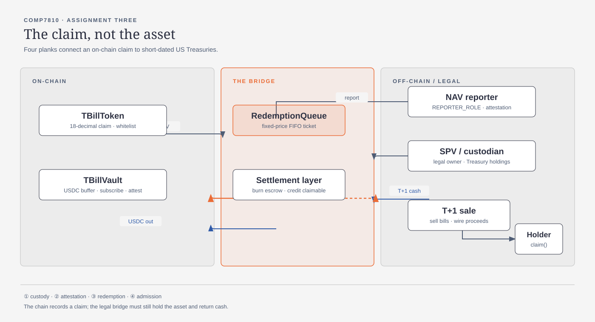
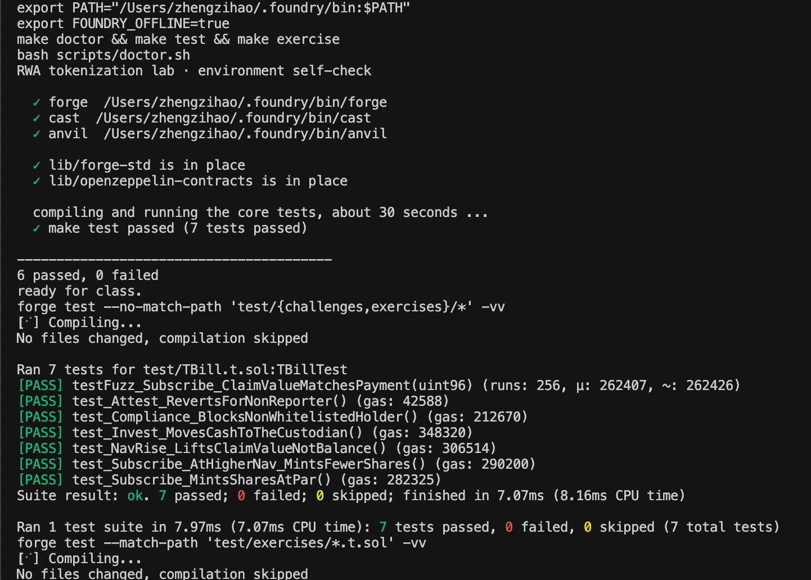
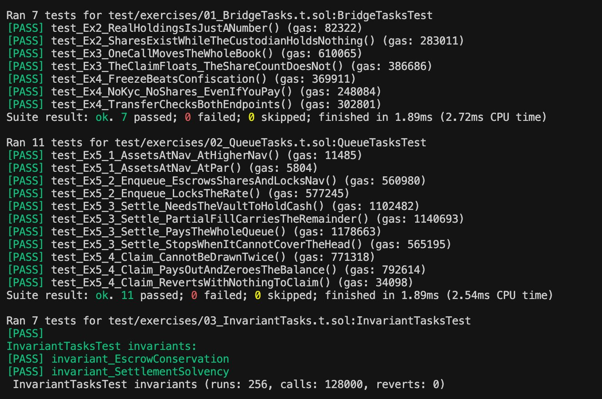
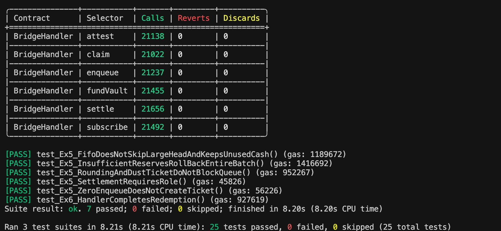

# Lab 2 — How to Tokenize an RWA (Tokenized T-Bills)

> **Repository:** <https://github.com/scnu001/RWA-assign-zzh>
> COMP7810 Assignment Three submission — exercises Ex0–Ex6 green, seven contracts deployed and
> verified on Sepolia, discussion questions answered in `STUDENT-QUESTIONS.md`.

In Lab 1 the collateral was **itself a token**. That is why the whole thing could prove itself:
`totalCollateral() == totalSupply()` was a statement the chain could check on its own, and nothing
outside the code had to be trusted.

This lab removes that assumption. The asset is now a **short-dated US Treasury bill**, sitting at a
custodian. What is on-chain is not the asset — it is a **claim on the asset**. The subject of this
lab is the machinery that connects the two:

> **The bridge.** Custody, attestation, physical redemption, and permissioning — the four things
> that have to exist before an off-chain asset can become an on-chain token, and the four places
> where such a token breaks.

Every exercise below is built around a plank of the bridge. If you find yourself only reading NAV
numbers and yields, you have drifted back into Lab 1.

---

## 1. Setup

Pick the track that matches your machine. **Everything after this section is identical for everyone.**

| You are on | Track |
|---|---|
| macOS / Linux | **A** — install Foundry locally |
| Windows | **B** — Codespaces, nothing installed on your machine |

> `lib/` (`forge-std`, `openzeppelin-contracts`) **ships inside this repository**.
> Neither track needs `git clone --recursive`, and neither needs `make setup` —
> a plain clone compiles as-is.

### Track A — macOS / Linux

**Step 1. Install Foundry**

First check whether you already have it:

```bash
forge --version
```

If that prints a version, skip to Step 2. Otherwise install it with the script in this repo (**do not use `foundryup`**):

```bash
bash scripts/install-foundry-cn.sh
```

The script detects your platform, tries GitHub directly, and falls back to the `gh-proxy.com`
mirror. Add the line it prints to `~/.zshrc` or `~/.bashrc`, then reopen your terminal:

```bash
export PATH="$PATH:$HOME/.foundry/bin"
```

> ⚠️ **Why not `foundryup`**: its download goes through GitHub's CDN, which times out reliably from
> mainland China. The mirror does not.

**Step 2. Get the code**

```bash
git clone https://github.com/hgwoops/rwa-lab-2026 && cd rwa-lab-2026
```

Then go to **Verify** below.

### Track B — Windows (Codespaces)

Foundry has **no native Windows binary**, so the straightforward path is to run the lab on
GitHub's servers from your browser. Nothing is installed locally, which also makes it the only
option on locked-down corporate machines.

1. Open <https://github.com/hgwoops/rwa-lab-2026>
2. Green **`Code`** button → **`Codespaces`** tab → **`Create codespace on main`**
3. **The first launch takes 2–5 minutes**: it builds the environment from `.devcontainer/`,
   then automatically runs `make doctor` — you should see a row of `✓` in the terminal
4. In the terminal at the bottom, run:

```bash
make test
```

`7 passed; 0 failed` means you are set.

The free tier is 120 core-hours/month — far more than this lab needs. **Stop it when you are done**
at <https://github.com/codespaces>; a running Codespace keeps burning quota.

### Verify (both tracks)

```bash
make doctor
```

In about 30 seconds this checks the toolchain, the dependencies, and runs the core tests. Anything
marked `✗` comes with the exact command to fix it. All green means you can start; if you cannot fix
it, paste the whole `make doctor` output to the TA.

> New to Foundry? Read **`FOUNDRY-101.md`** before you touch the tests: how a test is shaped, the
> cheatcodes you will need, the command band, and where to look when it breaks.

---

## 2. Quick start

```bash
make doctor        # environment check — all green before you go on
make test          # the checkpoint: core tests, should be all green (7 passed)
make exercise      # the hands-on tasks; red right now — the red ones ARE your task list
make anvil         # terminal A: start a local chain
make deploy-anvil  # terminal B: deploy to it
```

Deployment prints the admin plus seven contracts. Export the ones you need (`$USDC`, `$COMPLIANCE`,
`$FEED`, `$TBILL`, `$CUSTODIAN`, `$VAULT`, `$QUEUE`); the run-it-by-hand commands are in
`EXERCISES.md` Ex1.

**Your task list is `EXERCISES.md`** — every exercise's goal, acceptance command, and where to look.

---

## 3. What the contracts do

The bridge has four planks. Each one is a contract or a role in this repo.

| File | Role | Plank |
|---|---|---|
| `src/MockUSDC.sol` | **Cash.** 6 decimals, with a test faucet. The thing that flows across the bridge | — |
| `src/ComplianceRegistry.sol` | **The guest list.** `setWhitelisted()` / `isWhitelisted()`, gated by `COMPLIANCE_ROLE` | (d) admission |
| `src/TBillToken.sol` | **The claim.** ERC-20, **18 decimals**, mint/burn gated, and every balance change must pass both endpoints' whitelist | (d) admission |
| `src/TBillVault.sol` | **The on-ramp and the books.** `subscribe()` prices shares at the NAV; `attest()` is reporter-gated, but the mock feed also exposes an unrestricted setter | (b) attestation |
| `src/exercises/MockTBillCustodian.sol` | **The custodian stand-in.** `realHoldings()` reports a permissioned number; it does not prove Treasury ownership or custody | (a) custody |
| `src/exercises/MockPriceFeed.sol` | **The NAV oracle.** 8 decimals; `1.00e8` is par | (b) attestation |
| `src/exercises/RedemptionQueue.sol` | **T+1 model.** Shares in, a fixed-price ticket out, FIFO settlement and cash collection — Ex5 implemented | (c) redemption |

### The two invariants you will defend (Ex6)

```
escrow conservation   tBill.balanceOf(queue) == queue.pendingShares()
settlement solvency   usdc.balanceOf(queue) >= queue.totalClaimable()
```

The first says the queue never loses a share and never invents one. The second says it never owes
settled cash it does not hold. Neither is something the chain can verify against the off-chain
asset — that is the point. The three decimal scales (18 + 8 − 6) are in `EXERCISES.md` Ex5; the
third relation that *looks* like an invariant and is not is Ex6.

### Implementation boundaries

`enqueue` transfers approved shares to the queue and records their USDC value at that
moment's NAV. `settle` spends a maximum cash budget in FIFO order: a ticket is filled
completely or blocks every later ticket. Settlement transfers the ticket's cash from
the vault, burns its escrowed shares, removes its pending liabilities and credits
the owner. `claim` clears that credit before transferring USDC to the owner.
Unused settlement budget stays in the vault; it is not automatically deposited.

T+1 describes the external liquidation process, not a timer enforced by this mock.
An operator models returning proceeds with `depositReserves`. The mock custodian
does not execute a real Treasury purchase or sale. A NAV increase cannot create
USDC in the vault, so `reserveBalance() >= pendingAssets()` is not an invariant.
For Ex6, escrow equality is tested over the handler's controlled operations;
an unsolicited direct share transfer to the queue could break that equality outside
this model without losing any shares.

The supplied mock oracle deliberately remains unsuitable for production:
`setPrice` is unrestricted and `latestRoundData` supplies the current timestamp
even when no price update occurred. Whitelisting, queue correctness and green
invariant tests do not establish that reported off-chain assets exist.

`script/Deploy.s.sol` wires the whole system together, and the wiring at the bottom **is** part of
the lesson: the vault needs `MINTER_ROLE`; the queue needs `MINTER_ROLE` **and** must be
whitelisted (burning its escrowed shares is a balance change); the vault must be told where the
queue is; the custodian must recognize the vault. Skip any one and the loop reverts.

---

## 4. Homework

**Tier 1 (required)** — the exercises **Ex0–Ex6** in `EXERCISES.md`, and the discussion questions in
`STUDENT-QUESTIONS.md`. Ex1 is a warm-up and is **not graded**. A local Anvil is enough: Tier 1 does
**not** require a testnet. The acceptance command for every exercise is `make exercise` — green when
you are done.

**Tier 2 (20% in Assignment Three)** — deploy to Sepolia and verify the source on Etherscan; put **all seven**
addresses and their Etherscan links in your `README.md`, under a `## Deployment (Sepolia)` heading.
The deploy prints them in this order: `MockUSDC`, `ComplianceRegistry`, `MockPriceFeed`,
`TBillToken`, `MockTBillCustodian`, `TBillVault`, `RedemptionQueue`. The commands are Lab 1's
`README.md` §4, under "Tier 2 (bonus)" — the flow is identical.

**Tier 3 (challenge, optional)** — **Ex7**: `make challenge` (`test/challenges/FalseNav.t.sol`). The
reporter's number is the chain's only window onto the asset; show what happens when it lies, and
name the mechanism that would have caught it.

---

## 5. Common problems

**`Ownable` / role errors**
OpenZeppelin v5 has breaking changes, so v4 tutorials from the web will fail. This repo pins
`v5.0.2` — do not upgrade it.

**`subscribe` reverts with `NotWhitelisted`**
The token is permissioned. Whitelist the recipient first — and remember the **queue** must be
whitelisted too, because burning its escrowed shares counts as a balance change.

**`invest` reverts with `AccessControlUnauthorizedAccount`**
The custodian does not recognize the vault. `script/Deploy.s.sol` grants
`custodian.CUSTODIAN_ROLE()` to the vault — if you wired things by hand, you skipped it.

**Amounts are off by an order of magnitude**
`1000e6 = 1_000_000_000` in smallest units (USDC). Shares are 18 decimals and the NAV is 8 — the
conversion is `shares * nav / 1e20`. Do not compute 18-decimal to 18-decimal.

**Addresses change after restarting Anvil**
Anvil starts from a clean state every time, so you must redeploy.

**`make exercise` hangs, or an invariant failure looks strange**
Foundry replays a cached counterexample from `cache/invariant/` on the next run.
To search for a fresh one, `rm -rf cache/invariant` first.

---

## 6. Submission

Submission follows Lab 1: **one zip of the project** on Moodle, built from the project root.

The same tree is published at <https://github.com/scnu001/RWA-assign-zzh> (`main`, including the
vendored `lib/`). Test evidence, the Sepolia addresses and the architecture diagram all live in
this `README.md`.

Use the submission packager from the project root, after running the required tests:

```bash
make doctor
make test
make exercise
python3 scripts/package_submission.py
```

The packager selects submission files explicitly and excludes local credentials, build
outputs, broadcast records and reference copies. Keep the private `.env` outside the zip.
Do not zip the entire workspace: it contains an untouched reference checkout.

**Keep `lib/` inside it** — those vendored dependencies are what let the grader run `make test`
offline. Drop them and the grader has to fetch from GitHub.

What the zip must contain:

1. The code, with `make exercise` all green (the grader re-runs `make test` themselves)
2. Your answers to the discussion questions in `STUDENT-QUESTIONS.md`
3. An architecture diagram in your `README.md` — a photo of a hand drawing is fine, but it must
   show the **four planks** and where cash and shares cross the bridge



---

## 7. Questions left to you

The discussion prompts live in `STUDENT-QUESTIONS.md` — one per plank, no standard answers, and the
real point of this lab.

---

## Test evidence

The three screenshots below are the raw terminal output of the acceptance commands, run from the
project root in this order: `make doctor && make test && make exercise`.

**1. `make doctor` (6 passed, 0 failed) and `make test` (7 passed, 0 failed, 0 skipped)**

All three toolchain checks, both vendored dependency checks, and the seven core `TBill.t.sol`
tests — `test_Subscribe_MintsSharesAtPar`, `test_Subscribe_AtHigherNav_MintsFewerShares`,
`test_NavRise_LiftsClaimValueNotBalance`, `test_Invest_MovesCashToTheCustodian`,
`test_Attest_RevertsForNonReporter`, `test_Compliance_BlocksNonWhitelistedHolder` and the
`testFuzz_Subscribe_ClaimValueMatchesPayment` fuzz test (256 runs).



**2. `make exercise` — Ex2/Ex3/Ex4 (7 passed) and Ex5 (11 passed)**

`01_BridgeTasks.t.sol` covers custody, attestation and admission: the shares exist while the
custodian holds nothing, one `attest` re-prices the whole book, and all three admission failures
revert with the pinned `NotWhitelisted` selector. `02_QueueTasks.t.sol` covers the decimal
conversion (`1e20`), escrow-and-lock on `enqueue`, strict FIFO with an all-or-nothing head ticket,
and claim-once.



**3. Ex6 handler, both invariants, and the campaign totals**

The handler table shows the fuzzer actually reached `subscribe`, `attest`, `fundVault`, `enqueue`,
`settle` and `claim` (21k+ calls each, **0 reverts**), so the invariant campaign was not idling on
guarded calls. Both `invariant_EscrowConservation` and `invariant_SettlementSolvency` pass over
256 runs / 128,000 calls, and the run ends with `25 tests passed, 0 failed, 0 skipped`.



> A local Foundry 1.8.4 / Solidity 0.8.24 toolchain produced these results; the same checks are
> recorded in `docs/validation.md`. The screenshots live in `screenshots/`, which the submission
> packager deliberately does not include (it rejects raster artefacts), so the Markdown-only
> architecture diagram under `docs/` stays the packaged deliverable.

---

## Deployment (Sepolia)

Status: **deployed on Sepolia**. The formal Assignment Three PDF allocates 20% to
this section, overriding the older "bonus" wording in the lab slides.

| Contract | Sepolia address | Etherscan verified source |
|---|---|---|
| MockUSDC | [`0x50B60d20DEff7383F96bc0DD50df997555c2e230`](https://sepolia.etherscan.io/address/0x50B60d20DEff7383F96bc0DD50df997555c2e230) | [Etherscan](https://sepolia.etherscan.io/address/0x50B60d20DEff7383F96bc0DD50df997555c2e230#code) — verified |
| ComplianceRegistry | [`0x560D2FaE8ebeC253e4AA4C8222cc53953F66Ec71`](https://sepolia.etherscan.io/address/0x560D2FaE8ebeC253e4AA4C8222cc53953F66Ec71) | [Etherscan](https://sepolia.etherscan.io/address/0x560D2FaE8ebeC253e4AA4C8222cc53953F66Ec71#code) — verified |
| MockPriceFeed | [`0x462F9FAF5b90c758f5241675B009ff7e156B06B5`](https://sepolia.etherscan.io/address/0x462F9FAF5b90c758f5241675B009ff7e156B06B5) | [Etherscan](https://sepolia.etherscan.io/address/0x462F9FAF5b90c758f5241675B009ff7e156B06B5#code) — verified |
| TBillToken | [`0x1c99aD0A1679054E8E8Cf99F0E06A70f4B12E0C1`](https://sepolia.etherscan.io/address/0x1c99aD0A1679054E8E8Cf99F0E06A70f4B12E0C1) | [Etherscan](https://sepolia.etherscan.io/address/0x1c99aD0A1679054E8E8Cf99F0E06A70f4B12E0C1#code) — verified |
| MockTBillCustodian | [`0x519AC023169e5853851b13627Ef842Ccc6E29b73`](https://sepolia.etherscan.io/address/0x519AC023169e5853851b13627Ef842Ccc6E29b73) | [Etherscan](https://sepolia.etherscan.io/address/0x519AC023169e5853851b13627Ef842Ccc6E29b73#code) — verified |
| TBillVault | [`0x39c26b35C7FCA9F75Db44642137A548c99d04311`](https://sepolia.etherscan.io/address/0x39c26b35C7FCA9F75Db44642137A548c99d04311) | [Etherscan](https://sepolia.etherscan.io/address/0x39c26b35C7FCA9F75Db44642137A548c99d04311#code) — verified |
| RedemptionQueue | [`0x2d393C148a3cD420d868D791BBb5786f572b3C4A`](https://sepolia.etherscan.io/address/0x2d393C148a3cD420d868D791BBb5786f572b3C4A) | [Etherscan](https://sepolia.etherscan.io/address/0x2d393C148a3cD420d868D791BBb5786f572b3C4A#code) — verified |

The deployment used a throwaway test wallet funded with Sepolia ETH. Configure
`PRIVATE_KEY`, `SEPOLIA_RPC_URL` and `ETHERSCAN_API_KEY` locally in `.env`, with
file permissions `600`; `.env` is excluded from the submission archive.
Never use an Anvil default account on a public network and never paste secrets into this
README. After loading these variables in a private terminal:

```bash
# Confirm the endpoint is Sepolia (11155111) before broadcasting.
cast chain-id --rpc-url "$SEPOLIA_RPC_URL"
# Simulate first; this does not broadcast transactions.
forge script script/Deploy.s.sol:Deploy --rpc-url "$SEPOLIA_RPC_URL"
# Broadcast and verify creations only after the simulation succeeds.
forge script script/Deploy.s.sol:Deploy --rpc-url "$SEPOLIA_RPC_URL" \
  --broadcast --verify --etherscan-api-key "$ETHERSCAN_API_KEY"
```

All seven pages marked verified above display **Source Code Verified** on Etherscan.
The deployment also grants mint/burn roles, registers the queue, whitelists the
queue and admin, and grants the vault the custodian role. The on-chain wiring was
checked after deployment.

---

## Appendix — full text of `STUDENT-QUESTIONS.md`

The discussion answers are reproduced below in full and verbatim, as a convenience copy — the
graded source of truth stays `STUDENT-QUESTIONS.md` in the project root. Only heading levels were
shifted (the file's `#` title becomes `###`, its `##` sections become `####`) so the text nests
inside this appendix; no wording was altered.

### STUDENT-QUESTIONS.md — Discussion questions (goes inside your submission zip)

Answer directly under each question. Following the formal assignment, write
**150–300 words per group (A–D), combining both subquestions**, not per subquestion.
Keep the answers separate under their respective prompts — **reasoning over length**.

The sections follow the four planks of the bridge. There are no standard answers; these are the
real point of the lab.

---

#### A. Custody — where the asset actually is (plank a)

**A1.** In Lab 1, `totalCollateral()` read the vault's own ERC-20 balance, and the chain could
prove the invariant. Here, `MockTBillCustodian.realHoldings()` is just a number that a permissioned
address can move. Write the equivalent of `totalCollateral() == totalSupply()` for *this* system.
What does it actually assert, and what does it no longer prove?

> Your answer:

Without queued redemptions, the accounting target is
`vault.reserveBalance() + custodian.realHoldings() == vault.totalClaimValue()`,
with claims valued as `totalSupply() * navPerShare() / 1e20` in USDC units.
With the implemented queue, define R as vault reserves, H as reported holdings,
Q as queue cash, S as supply, P as pending shares, and N as NAV. The fuller
target is `R + H + Q == (S - P) * N / 1e20 + pendingAssets() + totalClaimable()`,
allowing rounding. Subtracting P avoids counting escrowed shares twice:
pendingAssets is unsettled fixed debt; totalClaimable is settled allocated cash.
Equality reconciles reports, not reality. `recordPurchase()` needs no cash
movement, so holdings prove neither ownership nor unencumbered backing.
Consistent valuations and complete liabilities are assumed. Custodian mock
cash must not duplicate reported purchases; zero holdings can coexist with
vault cash.

**A2.** The T-Bills are held by an SPV, a legal entity set up so the fund's assets are bankruptcy-
remote from the issuer. Explain in your own words why a *legal* structure is part of a *technical*
design. If the SPV's custodian goes bankrupt, what does the on-chain token entitle its holder to?

> Your answer:

An SPV's legal separation determines who can recover assets when technology
cannot enforce delivery. Bankruptcy remoteness from the issuer depends on
valid structure and operations; it does not eliminate custodian failure.
Properly segregated securities may be recoverable by the SPV outside the
custodian's general estate, but missing assets, liens, or commingling can
cause losses and delays. Token holders receive only the rights established
by fund documents, subscription and custody agreements, and applicable law:
potentially fund-share or contractual redemption rights, not necessarily
direct Treasury ownership or immediate USDC. `realHoldings()` proves none
of these protections. Production needs independent custody reconciliation,
investor records, and clear insolvency representation and procedures.

---

#### B. Attestation — how the chain learns the truth (plank b)

**B1.** `attest()` is the only function that moves the NAV, and it is gated by `REPORTER_ROLE`.
Everything downstream — subscription pricing, redemption payouts, both invariants — believes that
number. Name the failure modes of a single trusted reporter, and one mechanism (technical,
financial, or legal) that mitigates each.

> Your answer:

A single reporter can suffer key theft, fraud, mistakes, or downtime.
Hardware-backed keys and independent threshold approval mitigate theft;
independent valuations, custody reconciliation, and enforceable liability
deter fraud. Decimal validation and deviation limits catch input errors;
authentic timestamps, freshness gates, and replacement procedures address
unavailable or withholding reporters. Shared data sources still create
correlated failures. Predictable updates invite preferential trading, so
common dealing cutoffs matter. The current mock has an additional bypass:
although `attest()` requires `REPORTER_ROLE`, anyone can call
`MockPriceFeed.setPrice()`. Production must restrict that writer. False NAV
distorts subscriptions and locked redemptions even when escrow conservation
and settled cash coverage hold: those invariants verify bookkeeping, not
off-chain value.

**B2.** A production feed would check whether `updatedAt` is stale; this lab's mock does not. A
**frozen** NAV is a different attack from a **wrong** NAV. Describe how a stale-but-honest NAV can
be exploited by someone who knows the true value has moved.

> Your answer:

A frozen NAV may have been honest when observed. If true value rises from
1.00 to 1.05 while the feed stays unchanged, 1,000 USDC buys 1,000 shares
rather than approximately 952.38, diluting existing holders. If true value
falls to 0.95, an informed holder can enqueue 1,000 shares at the stale 1.00
price. `assetsLocked` remains 1,000 USDC after correction, shifting losses
to remaining investors if settled. Eligibility, FIFO, cash availability,
and settler authorization still constrain payment. `navPerShare()` ignores
timestamps; worse, the mock reports `block.timestamp` on every read,
disguising an unchanged observation as fresh. Real observation timestamps,
maximum ages, and forward-priced batches are needed; an age check against
this mock alone is ineffective.

---

#### C. Redemption — T+1 does not settle on-chain (plank c)

**C1.** The queue locks the payout at the NAV of **enqueue** time, not **settle** time. If the NAV
rises between the two, who gains and who loses — the redeemer, or the holders who stayed? Is that
the right allocation of risk, and how would you change it?

> Your answer:

Enqueueing 1,000 shares at 1.00 locks 1,000 USDC. A subsequent rise to 1.05
leaves the redeemer foregoing 50 of appreciation; genuine residual gains
economically benefit continuing holders under the fund's terms. A decline
reverses that allocation, encouraging early exits. The mock neither creates
cash nor automatically redistributes gains when NAV changes. I prefer
prospective forward pricing at a disclosed cutoff, with redemption costs
charged to that cohort. `vault.reserveBalance() >= queue.pendingAssets()`
is not universal: unsettled obligations may be backed by invested T-Bills,
requiring actual cash repatriation. By contrast,
`usdc.balanceOf(queue) >= queue.totalClaimable()` covers settled allocations.
The implemented settlement pulls reserves, burns escrowed shares, and
converts pending liabilities into claimable balances atomically.

**C2.** In a 2008 money-market fund breaking the buck, and in USDC's 2023 depeg, redemptions were
handled very differently. Compare the two. For a tokenized T-Bill fund, what does it mean to "close
the redemption channel", and what should happen to the queue when it does? Then look at the lever
this lab actually ships: `pause()` (`PAUSER_ROLE`) freezes transfers, minting **and** redemption
together — one switch, no partial setting. Why is that the wrong tool for a liquidity squeeze, and
what would you rather have?

> Your answer:

In 2008, Reserve Primary Fund losses led to breaking the buck, suspended
redemptions, and liquidation distributions. USDC's 2023 depeg combined
reserve uncertainty with weekend banking constraints; secondary trading
continued below par, while primary conversion recovered after deposit
protection and banking reopening. Closing a fund's channel should specify
whether requests or settlement stop, preserving ticket ownership, locked
amounts, and FIFO priority. Unfunded obligations must not become settled
allocations. `pause()` blocks tBILL transfers, minting, and burns through
`_update`, thereby blocking enqueue and ticket settlement. It does not block
already allocated USDC `claim()`: that function updates cash liabilities
and transfers USDC without touching tBILL. A liquidity squeeze need not
stop compliant transfers. Separate subscription, request, and settlement
gates, protected funded claims, and disclosed reopening criteria are
preferable; changing existing rights requires contractual authority.

---

#### D. Admission — the guest list and the backdoor (plank d)

**D1.** Every balance change in `TBillToken._update` checks **both** endpoints against the
whitelist. That is what stops a sanctioned address from receiving shares — and also what stops a
completely ordinary user who has not finished KYC. Where is the right line for a regulated fund,
and who should be able to move it?

> Your answer:

Admission should follow published KYC, sanctions, jurisdiction, and
investor-eligibility rules. Incomplete KYC justifies denying new shares,
not treating an ordinary applicant as a criminal. Existing holders need
proportionate freezes, documented reasons, and correction or appeal
procedures. `_update()` checks both nonzero endpoints, including mint
recipients and burn sources; a rejected subscription rolls back its USDC
transfer. The queue must also be whitelisted, while USDC claims have no
equivalent token-level screening. A compliance team should hold
`COMPLIANCE_ROLE`, with dual approval for sensitive changes and private
evidence off-chain. Legal and fund governance should approve policy
changes. An independent multisig should administer roles, since
`DEFAULT_ADMIN_ROLE` can undermine separation by granting new powers.

**D2.** A regulated fund asks for two levers: freeze an address (`setWhitelisted(addr, false)`) and
burn a balance (`MINTER_ROLE`) — both censorship tools, both justified by the product. But Ex4.3
shows the two **collide**: once an address is off the list, `burn()` reverts as well, because
`_update` guards both endpoints. So a freeze also blocks a seizure. Argue **both** sides of handing
an issuer these powers, then say what safeguards you would add and who should hold each key.

> Your answer:

Freezes and seizure powers can implement sanctions, court orders, and
fraud recovery. Conversely, mistakes, compromised keys, or coercion can
immobilize savings or erase balances. `MINTER_ROLE` combines minting with
burning another holder's shares without allowance; burning does not itself
extinguish legal rights. Ex4.3 exposes the collision: removing a holder
from the whitelist makes `_update()` reject even an authorized burn.
Temporary whitelisting could reopen transfers. I would assign freezes
to a compliance multisig, routine minting to the vault, and redemption
burns to the queue. A separate, narrowly scoped seizure role should require
legal and independent trustee approval while preserving the freeze.
Security officers should control emergency pausing; separate governance
should administer roles with delayed changes. Auditable case references,
notice, appeals, and reconciliation should accompany these proposed safeguards.

---

#### E. Tests (Tier 1 required — this is Ex2, Ex3 and Ex4)

Turn the red tests green in `test/exercises/01_BridgeTasks.t.sol` to cover the scenarios below, and
write your test function names here:

| Plank | Scenario | Your test function name |
|---|---|---|
| a | Shares exist while the custodian holds nothing | `test_Ex2_SharesExistWhileTheCustodianHoldsNothing` |
| a | `realHoldings()` moves with no cash moving | `test_Ex2_RealHoldingsIsJustANumber` |
| b | The claim value floats while the share count stays | `test_Ex3_TheClaimFloats_TheShareCountDoesNot` |
| b | One `attest` re-prices every holder at once | `test_Ex3_OneCallMovesTheWholeBook` |
| d | A non-whitelisted address cannot receive shares, even by paying | `test_Ex4_NoKyc_NoShares_EvenIfYouPay` |
| d | A whitelisted holder cannot send shares to a non-whitelisted address | `test_Ex4_TransferChecksBothEndpoints` |
| d | Removing an address freezes that holder — and blocks a burn | `test_Ex4_FreezeBeatsConfiscation` |

These are the original seven function names, verified against the local and
reference exercise files. Their root-project bodies now contain scenario
assertions rather than placeholders. This update is based on source inspection;
no test execution or passing result is claimed here.

Then write one more scenario you consider **most likely to be exploited** on a tokenized fund, and
say which plank it breaks:

> Your answer:

My leading practical scenario is stale-NAV arbitrage, breaking plank (b),
attestation, and transmitting losses through plank (c), redemption. This is
a reasoned threat choice, not an empirical frequency claim. A whitelisted
holder learns that the portfolio has lost value while the published NAV is
unchanged, then queues a redemption at the older, higher price. In the
implemented queue, `assetsLocked` preserves that price even after an
honest update. If sufficient cash arrives and an authorized settler honors
the ticket, the holder exits at remaining investors' expense. The attacker
needs timely information and eligibility, not a stolen reporter key.

The distinguishing assertions for a future test would be that the old
observation remains unchanged as time advances, the request captures that
old NAV, and a subsequent lower NAV does not reduce the locked payout.
Settlement should still require actual reserves, and any credited
`totalClaimable()` must remain cash-covered; accounting invariants alone
would not detect the unfair valuation.

For this particular mock, unrestricted `setPrice()` is an even more direct
price-manipulation route and must be closed before production. Authentic
observation timestamps, freshness gates, and forward-priced dealing windows
address the stale-price scenario. This document update adds no test and
claims no test execution, deployment, or demonstrated exploitation.
